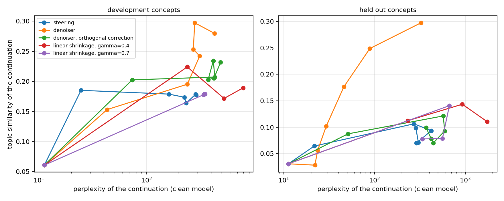

# Repairing the damage that activation steering does

Steering a language model by adding a direction to its residual stream,
`h <- h + alpha*v`, needs an `alpha` comparable to `||h||` before the target
property appears in the text. At that strength the state is far outside the
range the later layers were trained on and the text degrades. The trade-off is
usually drawn as a front: concept presence against fluency.

This repository asks what to do with the steered state before the model
continues to read it, and answers with a small denoiser trained on natural
activations plus one change in how its output is used.

## Results

Held-out concepts, mean over four. `seed` and `probe` are words per 100
generated words from two disjoint lexicons: the direction is built from the
seed words, the probe words are never seen by it.

| mode | alpha | topic | seed/100 | probe/100 | perplexity | distinct-2 |
|---|---|---|---|---|---|---|
| unsteered | 0 | 0.031 | 0.00 | 0.10 | 11.3 | 0.875 |
| steering | 0.4 | 0.106 | 0.00 | 0.17 | 272.0 | 0.784 |
| steering | 1.0 | 0.071 | 0.00 | **0.00** | 304.4 | 0.443 |
| steering | 1.5 | 0.099 | 0.00 | **0.00** | 285.6 | 0.277 |
| denoiser | 0.6 | 0.102 | 0.10 | 1.34 | **29.4** | 0.796 |
| denoiser | 1.0 | 0.249 | 2.40 | **4.16** | 88.8 | 0.742 |
| denoiser | 1.5 | **0.297** | 15.99 | 3.68 | 325.6 | 0.660 |
| orthogonal | 1.0 | 0.078 | 0.00 | 0.00 | 421.4 | 0.398 |

Plain steering at alpha >= 0.6 emits **no** probe words at all: it raises the
probability of exactly the eight tokens the direction was built from and
nothing beyond them. The denoiser at alpha = 1.0 emits 4.16 probe words per 100
against 2.40 seed words -- more generalised vocabulary than literal. It reaches
a topic score of 0.249 where steering never exceeds 0.106, at a third of the
perplexity.



Two alternative explanations were tested and rejected. Attenuation alone: the
denoiser keeps 8-48% of the injection, and plain steering across that effective
range reaches only 0.065-0.106. Generic contraction: replacing the denoiser with
`x <- mu + gamma (x - mu)` gives perplexity 928 (gamma=0.4) and 561 (gamma=0.7)
at alpha=1.0, against the denoiser's 88.8 -- worse than plain steering, and no
contraction setting lands on the Pareto front.

The refinement proposed in the method below -- protecting the injected component
from the denoiser -- was measured and does **not** work. The denoiser cancels
52-92% of what was injected, and that cancellation turns out to be the mechanism
rather than a defect. See `report/report.md`, section 5, for the evidence and
for the control that rules out "the denoiser is just a smaller alpha".

## Method

A residual MLP `D` is fitted to natural residual-stream activations at the
intervention layer, with the corruption suggested by the task statement:

```
h_noisy = t*h + (1 - t)*eps,   t ~ U[0,1],  eps ~ N(0, I)
L = || h - D(h_noisy) ||^2
```

It never sees a steering vector, so every evaluation direction is held out by
construction rather than by a split.

The naive application is `h~ = D(h + alpha*v)`. A prior fitted to natural
activations treats the injected component as the anomaly, and the measurement
confirms it: the denoiser cancels 52 to 92 per cent of what was injected
(`results/analysis.json`). The obvious refinement is to protect that component
and apply only the orthogonal part of the correction:

```
x  = h + alpha*v
h~ = x + P_perp_v [ D(x) - x ]
```

Both are implemented and compared. The refinement loses: the cancellation turns
out to be the mechanism rather than a defect, and forcing full injection
strength leaves the state off-manifold and the text degenerates into repetition.
The report works through the evidence, including the control that rules out
"the denoiser is just a smaller alpha".

## Measurement

| axis | quantity |
|---|---|
| concept presence | cosine of the continuation's embedding with a topic sentence |
| lexical generalisation | probe-lexicon words per 100 generated words |
| fluency | perplexity of the continuation under the **unmodified** model |
| degeneracy | distinct-2 |

Each concept has two disjoint lexicons: `seed` words build the direction,
`probe` words score the text. A lexical counter alone is not enough: a direction
built from eight tokens promotes those tokens, so the probe lexicon reads 0.00
on text that is unmistakably on topic. Perplexity is taken under the clean
model, because a strongly steered model finds its own degenerate output
perfectly predictable -- and perplexity alone is not enough either, because a
repetition loop scores well on it, which is why distinct-2 is reported beside
it.

Four concepts (`medicine`, `law`, `space`, `cooking`) were used while fixing
the alpha grid, the architecture and the decoding parameters. Four
(`finance`, `sports`, `music`, `weather`) were run once, at the end.

## Reproduction

CPU only.

```bash
pip install -r requirements.txt
pytest -q
python -m scripts.build_activations
python -m scripts.train_denoiser
python -m scripts.run_pareto
python -m scripts.analyze
```

## Layout

Trained denoiser: [mariakasimceva/steering-denoiser](https://huggingface.co/mariakasimceva/steering-denoiser).

```
msteer/concepts.py   concepts, seed and probe lexicons, dev / held-out split
msteer/hooks.py      GPT-2 with one intervention point after block 6
msteer/vectors.py    steering directions as a difference in means
msteer/denoiser.py   the prior, its training corruption, and the three modes
msteer/generate.py   batched generation under an intervention
msteer/metrics.py    concept rate, continuation perplexity, distinct-n
scripts/             data, training, the alpha sweep, tables and figures
report/report.md     the study
tests/               lexicon disjointness, the invariant of the orthogonal mode
```
