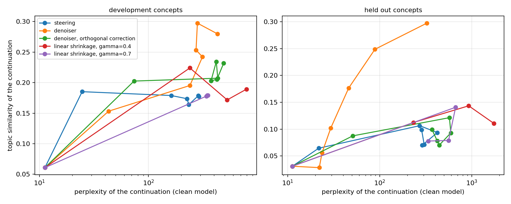

# Activation steering и обучаемый denoiser

Эксперимент с GPT-2: можно ли сохранить тематическое воздействие на скрытые представления и уменьшить ухудшение текста после activation steering.

## Метод

В residual stream добавляется направление: `h + alpha*v`. Небольшой residual MLP обучается восстанавливать естественные активации из зашумлённых; steering-направления при обучении denoiser не используются. Сравниваются обычный steering, коррекция denoiser, коррекция только ортогональной компоненты и контрольные преобразования.

Четыре темы используются при настройке эксперимента, ещё четыре — для финальной оценки. Лексиконы построения направления и проверки новых тематических слов не пересекаются.

## Результаты

При alpha=1 в базовом запуске: perplexity 304,4 → 88,8; distinct-2 0,443 → 0,742. Тематическое сходство — 0,249, число проверочных тематических слов — 4,16 на 100 слов. Perplexity исходной модели без вмешательства — 11,3: снижение относительно steering не означает превосходство над исходной моделью.

На трёх обученных denoiser perplexity составляет 88,79 / 68,31 / 114,96, среднее 90,69; тематическое сходство — 0,2487 / 0,2025 / 0,2529. Коррекция только ортогональной компоненты не улучшила результат. Полный разбор компромисса между тематикой и качеством — [report/report.md](report/report.md).



Perplexity измеряется исходной моделью, тематическое сходство — отдельным эмбеддером; distinct-2 контролирует повторы. Эти автоматические оценки не заменяют независимую оценку содержания человеком.

## Запуск

```bash
pip install -r requirements.txt
python -m scripts.build_activations
python -m scripts.train_denoiser
python -m scripts.run_pareto
python -m scripts.analyze --denoiser-seed 0
python -m pytest -q
```

Основной код — `msteer/`, параметры и результаты — `results/`. Анализ от 10.10.2026 обработал 248 сохранённых записей с явным разделением seed; это повторный анализ генераций, а не новое обучение. Для пересчёта декомпозиции используйте `--decomposition`.
