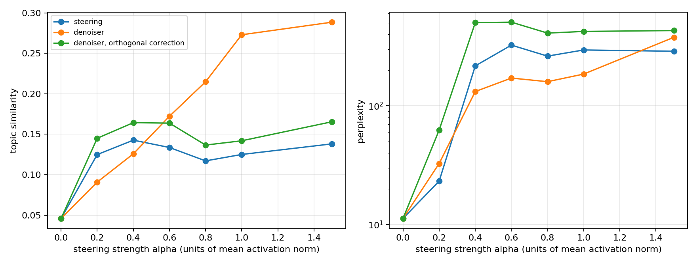

# Как чинить состояние после стиринга

GPT-2 small, интервенция после блока 6 из 12. Всё считалось на CPU.

## 1. Постановка

Интервенция `h ← h + αv` требует `α`, сопоставимого с `‖h‖`, чтобы свойство
проявилось в тексте. При такой силе состояние выходит за пределы области, на
которой обучались последующие слои, и текст деградирует. Исследуется, что
сделать с состоянием после интервенции, прежде чем модель продолжит его читать.

## 2. Метод

**Априор.** Остаточная MLP `D` (6.9 млн параметров, 2 блока, скрытый слой 2048)
обучена на 68 268 естественных активациях слоя 6 из wikitext-2 с порчей

```
h_noisy = t·h + (1 − t)·ε,   t ~ U[0,1],  ε ~ N(0, I)
L = ‖h − D(h_noisy)‖²
```

в пространстве, стандартизованном обучающими средним и дисперсией.
Интерполяционная форма выбрана вместо `h + ε`: она покрывает весь диапазон
повреждения при ограниченной норме входа, а состояние `h + αv` при больших `α`
лежит далеко за пределами того, что дала бы фиксированная `σ`.

Денойзер не видит ни одного вектора стиринга. Валидационные направления held-out
по построению, а не по разбиению.

**Два способа применения.**

```
x        = h + αv
denoise  : h̃ = D(x)
denoise_orth : h̃ = x + P_⊥v [ D(x) − x ]
```

Гипотеза перед запуском: наивный вариант дефектен, поскольку априор, обученный
на естественных состояниях, считает аномалией саму внедрённую компоненту и
гасит её; ортогональный вариант сохранит вмешательство в полной силе и снимет
только артефакты. Гипотеза не подтвердилась — раздел 5.

## 3. Измерение

| ось | величина |
|---|---|
| присутствие концепта | косинус эмбеддинга продолжения (MiniLM) с тематическим предложением |
| лексическое обобщение | probe-слова на 100 слов, лексикон не пересекается с seed |
| связность | перплексия продолжения под немодифицированной моделью |
| вырожденность | distinct-2 |

Три замечания, каждое из которых вытекает из наблюдения, а не из общих
соображений.

**Почему тематическая близость, а не подсчёт слов.** Направление, построенное
как разность средних по восьми seed-токенам, продвигает именно эти токены.
При α=1 текст выглядит так: `nurse and nurse for and nurse that and nurse in a
Patient Sy`. Он безошибочно медицинский, но probe-лексикон (`disease`,
`treatment`, `symptoms`, …) даёт ровно 0.00. Лексический счётчик оставлен как
вторая, более строгая мера обобщения за пределы seed-слов.

**Почему перплексия под чистой моделью.** Под стирингованной она вырождена:
модель с сильной интервенцией идеально предсказывает собственный вырожденный
вывод.

**Почему перплексии недостаточно.** На концепте `medicine` вариант
`denoise_orth` при α=0.8 даёт перплексию 33.7 — вдвое лучше, чем стиринг при
α=0.2. При этом distinct-2 = 0.065 и 83 seed-слова на 100: это цикл
`nurse nurse Patient nurse`. Повтор предсказуем, поэтому перплексия его
поощряет. Ось связности здесь двумерна, и обе координаты приводятся.

**Разделение концептов.** `medicine`, `law`, `space`, `cooking` использовались
при фиксации сетки `α`, архитектуры и метрики. `finance`, `sports`, `music`,
`weather` прогонялись один раз, в конце. Разделение касается не денойзера, а
решений, принятых при взгляде на результаты.

Каждая точка — 48 генераций по 32 токена (16 промптов × 3 сида), промпты и сиды
общие для всех режимов.

## 4. Результаты

Held-out концепты, среднее по четырём. `seed` и `probe` — слова на 100
сгенерированных слов; лексиконы не пересекаются.

| режим | α | topic | seed/100 | probe/100 | ppl | distinct-2 |
|---|---|---|---|---|---|---|
| без вмешательства | 0 | 0.031 | 0.00 | 0.10 | 11.3 | 0.875 |
| стиринг | 0.2 | 0.065 | 0.02 | 0.25 | 21.7 | 0.814 |
| стиринг | 0.4 | 0.106 | 0.00 | 0.17 | 272.0 | 0.784 |
| стиринг | 0.6 | 0.094 | 0.00 | **0.00** | 423.4 | 0.682 |
| стиринг | 1.0 | 0.071 | 0.00 | **0.00** | 304.4 | 0.443 |
| стиринг | 1.5 | 0.099 | 0.00 | **0.00** | 285.6 | 0.277 |
| денойзер | 0.6 | 0.102 | 0.10 | 1.34 | **29.4** | 0.796 |
| денойзер | 0.8 | 0.176 | 0.39 | 3.16 | 46.0 | 0.771 |
| денойзер | 1.0 | 0.249 | 2.40 | **4.16** | 88.8 | 0.742 |
| денойзер | 1.5 | **0.297** | 15.99 | 3.68 | 325.6 | 0.660 |
| ортогональный | 0.4 | 0.121 | 0.00 | 0.58 | 572.4 | 0.761 |
| ортогональный | 1.0 | 0.078 | 0.00 | 0.00 | 421.4 | 0.398 |
| ортогональный | 1.5 | 0.099 | 0.00 | 0.00 | 371.1 | 0.292 |

**Главный результат — колонка probe.** Чистый стиринг при α ≥ 0.6 не производит
ни одного probe-слова: он поднимает вероятность ровно тех восьми токенов, из
которых построено направление, и ничего сверх. Денойзер при α = 1.0 даёт 4.16
probe-слова на 100 при 2.40 seed-слов, то есть обобщённой лексики больше, чем
буквальной. Это измерение не зависит от эмбеддера и не может быть объяснено
повтором seed-токенов: probe-лексикон с ними не пересекается по построению
(`tests/test_core.py::test_seed_and_probe_lexicons_are_disjoint`).

По остальным осям: денойзер при α = 1.0 даёт topic 0.249 против потолка 0.106 у
стиринга, при перплексии 88.8 против 272.0 и distinct-2 0.742 против 0.784 —
выигрыш по присутствию концепта и по связности одновременно. При α = 0.6 он
воспроизводит лучший результат стиринга (topic 0.102 против 0.106) при
перплексии 29.4 против 272.0, то есть в девять раз дешевле.

Разброс по четырём held-out концептам в ключевой точке (денойзер, α = 1.0):
topic 0.249 ± 0.069 (стандартное отклонение по концептам). Это разброс по
направлениям, а не по сидам обучения; см. раздел 6.


Фронт: `denoise` занимает весь высокоинтенсивный участок, стиринг — только
низкоинтенсивный конец. Недоминируемые конфигурации по (topic, ppl) среди всех 200 прогонов: `steer`
при α ∈ {0, 0.2} — низкоинтенсивный конец, и `denoise` при α ∈ {0.6, 1.0, 1.5} —
весь остальной фронт. Ортогональный вариант попадает туда единственной точкой
(α = 0.2), линейное сжатие — ни одной.



На development-концептах картина та же, но слабее: стиринг выходит на плато
topic ≈ 0.18 уже при α = 0.2, денойзер достигает 0.297 при α = 1.0.

### 4.1. Устойчивость по сидам обучения денойзера

Денойзер обучен трижды, с разной инициализацией и разным порядком батчей.
Held-out концепты, среднее по четырём, значение на каждом сиде и половина размаха:

| режим | α | сид 0 | сид 1 | сид 2 | topic | probe/100 |
|---|---|---|---|---|---|---|
| стиринг | 0.6 | 0.094 | 0.094 | 0.094 | 0.094 ± 0.000 | 0.00 |
| стиринг | 1.0 | 0.071 | 0.071 | 0.071 | 0.071 ± 0.000 | 0.00 |
| стиринг | 1.5 | 0.099 | 0.099 | 0.099 | 0.099 ± 0.000 | 0.00 |
| денойзер | 0.6 | 0.102 | 0.098 | 0.118 | 0.106 ± 0.010 | 1.20–1.84 |
| денойзер | 1.0 | 0.249 | 0.202 | 0.253 | **0.235 ± 0.025** | 3.91–4.87 |
| денойзер | 1.5 | 0.297 | 0.284 | 0.310 | **0.297 ± 0.013** | 3.68–6.24 |

Стиринг по сидам не меняется по построению: денойзер в нём не участвует, а
промпты и сэмплирование фиксированы. Разброс денойзера — 0.013–0.025 при
величине эффекта 0.14–0.20 над стирингом, то есть на порядок меньше. Число
probe-слов положительно на каждом из трёх сидов (3.68–6.24), у стиринга — ровно
ноль на каждом. Вывод не зависит от конкретной подгонки.

## 5. Механизм и опровергнутая гипотеза

Разложение коррекции `δ = D(x) − x` по направлению `v` (`results/analysis.json`):

| концепт | α | доля инъекции, сохранённая денойзером | ‖δ‖ | ‖δ_⊥‖ |
|---|---|---|---|---|
| medicine | 1 | 0.407 | 288.7 | 252.2 |
| law | 1 | 0.477 | 428.0 | 411.3 |
| space | 1 | 0.097 | 200.4 | 42.6 |
| cooking | 1 | 0.079 | 204.1 | 41.8 |

Денойзер гасит от 52% до 92% внедрённой компоненты — ровно то, что
предсказывала исходная гипотеза. Но вывод из этого был сделан неверный.
Ортогональный вариант, который эту компоненту защищает, работает хуже наивного
по обеим осям: на held-out при α=1.5 topic 0.099 против 0.297 и перплексия 371
против 326. Гашение оказалось не дефектом, а механизмом. Денойзер действует как
обученный, зависящий от состояния коэффициент усиления: он ослабляет инъекцию
ровно настолько, чтобы состояние вернулось в область, где последующие слои
работоспособны, и одновременно снимает ортогональные артефакты (‖δ_⊥‖ от 42 до
411 при ‖h‖ ≈ 217). Принудительное сохранение полной силы вмешательства
оставляет состояние вне многообразия, и модель вырождается в повтор.

**Альтернативное объяснение и его проверка.** Раз денойзер сохраняет 8–48%
инъекции, он мог бы быть эквивалентен обычному стирингу с меньшим `α`. Тогда при
α=1.0 он был бы эквивалентен стирингу с эффективным α от 0.08 до 0.48. Эта
область измерена напрямую: стиринг при α=0.2 даёт topic 0.065, при α=0.4 — 0.106.
Денойзер при α=1.0 даёт 0.249. Эквивалентности нет: ослабление инъекции
объясняет сохранность текста, но не рост присутствия концепта. За него отвечает
ортогональная часть коррекции, которая по норме сопоставима с полной.

**Второе альтернативное объяснение: достаточно любого сжатия.** Раз стиринг
раздувает норму состояния, помочь могло бы тривиальное стягивание к центру
распределения активаций, `x ← μ + γ(x − μ)`, и тогда обученный априор на 6.9 млн
параметров был бы не нужен. Развёртка по α этого не проверяет: α меняет размер
инъекции до вмешательства, а сжатие действует после и трогает в том числе
естественную часть `h`. Контроль прогнан на held-out концептах в той области, где
денойзер выигрывает:

| режим | α | topic | probe/100 | ppl | distinct-2 |
|---|---|---|---|---|---|
| денойзер | 1.0 | **0.249** | **4.16** | **88.8** | 0.742 |
| сжатие, γ=0.4 | 1.0 | 0.143 | 2.50 | 927.6 | 0.656 |
| сжатие, γ=0.7 | 1.0 | 0.079 | 0.03 | 560.9 | 0.623 |
| денойзер | 1.5 | **0.297** | **3.68** | **325.6** | 0.660 |
| сжатие, γ=0.4 | 1.5 | 0.111 | 0.45 | 1745.8 | 0.778 |
| сжатие, γ=0.7 | 1.5 | 0.078 | 0.00 | 336.7 | 0.372 |
| стиринг | 1.0 | 0.071 | 0.00 | 304.4 | 0.443 |

Сжатие не воспроизводит фронт денойзера и по связности хуже самого стиринга:
перплексия 928 и 561 против 88.8. Ни одна конфигурация сжатия не попадает в
недоминируемое множество. Линейное стягивание убирает норму, но вместе с ней и
структуру состояния; обученный априор возвращает состояние в область данных, а не
к их центру. Объяснение «помогло бы любое сжатие» отвергнуто.

Заметно, что доля сохранённой инъекции сильно зависит от концепта: 0.41–0.48 для
`medicine` и `law` против 0.08–0.10 для `space` и `cooking`. Направления, хуже
согласованные с многообразием активаций, гасятся сильнее. Это предсказывает, что
метод даёт меньший прирост для направлений, лежащих далеко от главных компонент
активаций, — проверяемое следствие, которое здесь не проверялось.

## 6. Границы

- Три сида обучения денойзера (раздел 4.1) покрывают инициализацию и порядок
  батчей, но не набор промптов и не выбор концептов: те фиксированы. Разброс по
  четырём held-out концептам в ключевой точке — 0.069, он больше разброса по
  сидам (0.025), то есть доминирующий источник неопределённости — выбор
  направления, а не подгонка денойзера.
- Одна модель (GPT-2 small), один слой интервенции, одно семейство направлений
  (разность средних). Направление, построенное как разность средних по восьми
  токенам, продвигает эти токены, а не понятие; на SAE-направлениях режим может
  быть иным. Перенос не проверялся.
- Тематическая близость по MiniLM — прокси. Она засчитывает повтор seed-слов как
  присутствие концепта, поэтому приводится вместе с distinct-2 и probe-счётчиком.
  Ни одна из трёх осей по отдельности не была бы достаточной.
- Денойзер применяется на каждом шаге генерации ко всем позициям. Стоимость —
  один прямой проход MLP на позицию, порядка 1% от стоимости блока GPT-2.
- Перплексия на held-out при α=1.5 всё ещё 326 против 11.3 без вмешательства.
  Метод сдвигает фронт, но не убирает компромисс.

## 7. Следующий эксперимент

Разложение показывает, что полезная часть работы денойзера — ортогональная
коррекция, а гашение вдоль `v` служит регуляризацией силы. Отсюда прямой
следующий шаг: разделить эти две функции и управлять ими независимо —

```
h̃ = h + β(x)·αv + P_⊥v [ D(x) − x ],   β(x) = проекция D(x) на v / (α‖v‖)
```

с `β` как свободным параметром вместо выученного. Это позволило бы проверить,
существует ли `β`, при котором ортогональная коррекция даёт прирост, а сила
вмешательства не теряется, — то есть отделить вклад двух компонент, которые в
наивном варианте связаны.

## Артефакты

- Денойзер: [mariakasimceva/steering-denoiser](https://huggingface.co/mariakasimceva/steering-denoiser),
  6.9 млн параметров. Тот же файл в репозитории: `checkpoints/denoiser.pt`,
  гиперпараметры и история обучения — `checkpoints/denoiser.json`.
- `results/pareto.jsonl` — 152 конфигурации, сырые числа.
- `results/tables.md`, `results/figures/` — сводные таблицы и графики.
- `results/analysis.json` — разложение коррекции.
